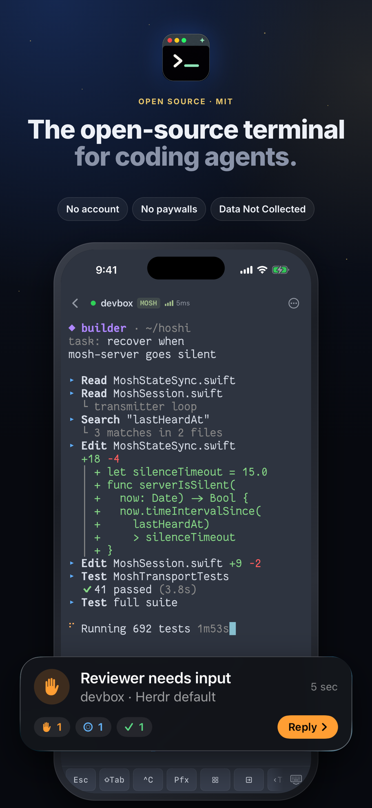
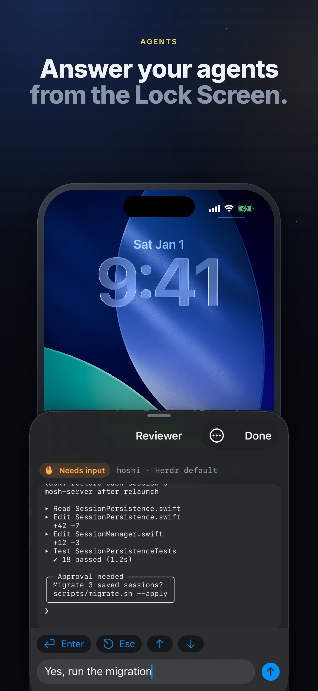
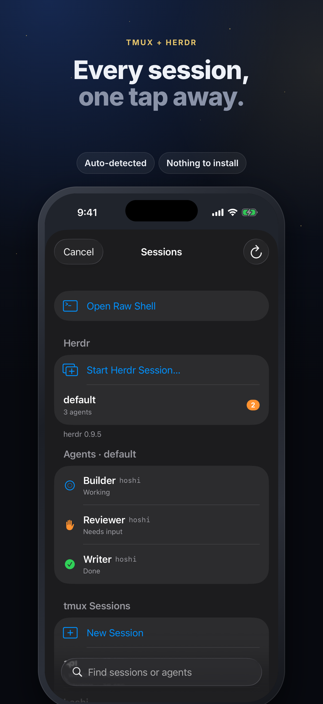

# Hoshi

## Human written summary

A terminal app for iOS made with love. I wanted to build an open source terminal app that I would use myself. It brings all the features I couldn't leave without, like click and hold for arrows, copy and paste and moshi support.

I recently started using Herdr a lot, so on top of the pre-existing tmux support, I also added support for it.

## AI Project Description

Hoshi (星, "star" in Japanese) is an SSH and Mosh terminal for iPhone and iPad, built for checking in on coding agents running on your own machines. Tap a server and you're back in your tmux or Herdr session. See what your agents are doing, reply to one, and put the phone away.

<a href="https://apps.apple.com/app/id6760631255">
  
</a>

<p align="center">
  
  &nbsp;&nbsp;
  
  &nbsp;&nbsp;
  
</p>

## Highlights

- **A real terminal engine.** Hoshi renders with [Ghostty](https://ghostty.org) on Metal, so full-screen apps like vim, htop, and Claude Code look the way they do on your desktop.
- **Mosh, written from scratch in Swift.** Sessions survive switching between Wi-Fi and cellular, sleeping the phone, and changing networks. Lost packets are resent. When mosh-server can't start, Hoshi tells you why and how to fix it, then falls back to SSH.
- **Arrow keys you can hold.** Long-press the arrow key and drag in any direction for a joystick. Swipe on the toolbar to send arrows too.
- **Copy and paste that works.** Long-press to select, drag the handles, and copy. Paste waits for your approval when the text could do damage.
- **tmux and Herdr, built in.** Hoshi finds your tmux sessions, or attaches to a Herdr session or agent, and remembers your choice for the next connection.
- **Your agents at a glance.** See which Herdr agents are working, waiting, or done. Reply to one without leaving the app, and follow it on the Lock Screen and Dynamic Island with Live Activities.
- **A keyboard that knows where you are.** The toolbar shows a different key set in a shell, in tmux, and in Herdr. It has sticky Ctrl, Opt, and Shift, custom keys, and a palette of Herdr actions.
- **Several servers at once.** Keep up to five sessions open and swipe between them using live thumbnails. On iPad, each session gets its own terminal in split view.
- **Private by design.** There's no account, analytics, advertising, or required cloud service. Hoshi verifies every server's host key, stores credentials in the Keychain, and transcribes voice prompts on the device.
- **One purchase.** No subscription.

## Features

### Connections

- Mosh and SSH, with password or key authentication (Ed25519, RSA)
- SSH keys generated on the device. Share only the public key, from the iOS share sheet.
- A host-key trust prompt on first connect, and a Known Hosts list to review or remove servers later
- Automatic reconnection. Sessions you had open are restored when you relaunch the app.

### tmux and Herdr

- tmux sessions detected on connect, with name, window count, attached status, and recent activity
- Attach automatically, create a named session, or choose a raw shell
- Herdr detection: attach to a Herdr session or jump straight to one agent's pane
- Reach agents on other machines listed in the host's Herdr

### Coding agents

- A local inbox for finished jobs, attention requests, and approvals, with optional notifications
- Lock Screen and Dynamic Island Live Activities that show agent status without revealing its content
- Notification taps open the right terminal. Approvals never run commands on their own.
- Optional hooks and a self-hosted companion for setups where tmux or Mosh swallow terminal events (see [below](#agent-hooks-and-self-hosted-companion))

### Typing and touch

- Customizable toolbar with Esc, Tab, ^C, function keys, and symbols. Drag buttons to reorder them.
- Tap to click in vim, htop, and on URLs. Pan to scroll. Pinch to change the font size.
- Text selection with draggable handles, plus a scrollbar overlay
- Private voice prompts: push to talk, on-device speech recognition, and an editable draft before anything is sent

### Files

- Browse and search the server's home directory over a verified SSH/SFTP connection
- Preview and share downloads, which are kept privately and erased when you close the browser or Hoshi locks
- Upload documents or photos (without full photo-library access), with progress, cancellation, and cleanup
- Optionally insert the uploaded file's path into the terminal

### Appearance

- More than 50 bundled Nerd Fonts
- Themes including Nord, Dracula, Solarized, Gruvbox, Tokyo Night, and Catppuccin
- Cursor style, background opacity, scroll speed, and haptics

## Tech Stack

- **Swift** / **SwiftUI**, iOS 18.0+
- **GhosttyKit**: Metal-accelerated terminal rendering from an embedded xcframework
- **Citadel**: SSH client
- **CryptoSwift**: AES-OCB encryption for Mosh
- **SwiftData** for server profiles, **Keychain Services** for credentials
- **Speech / AVFoundation** for on-device dictation

The Mosh client is implemented from scratch in Swift, covering the UDP transport, the State Synchronization Protocol, and AES-OCB encryption.

## Building

The quickest way to build Hoshi needs only Xcode, [XcodeGen](https://github.com/yonaskolb/XcodeGen), and ripgrep. It downloads a GhosttyKit framework that this repository's CI built and published:

```bash
brew install xcodegen ripgrep
./scripts/bootstrap.sh --prebuilt
open Hoshi/Hoshi.xcodeproj
```

See [CONTRIBUTING.md](CONTRIBUTING.md) to send changes back, and [AGENTS.md](AGENTS.md) for the build, test, and code map in detail.

### Building GhosttyKit yourself

If you change `vendor/ghostty`, `vendor/libxev`, or the GhosttyKit build scripts, build the framework locally. Hoshi requires a full Xcode installation with the iOS SDK, plus
[XcodeGen](https://github.com/yonaskolb/XcodeGen), Zig 0.15.2, and
ripgrep. Its generated Ghostty framework is not committed, so initialize the
submodules and build the framework before opening the project.

```bash
# Select and initialize the full Xcode installation once
sudo xcode-select --switch /Applications/Xcode.app/Contents/Developer
sudo xcodebuild -runFirstLaunch

# Install the build prerequisites
brew install xcodegen zig@0.15 ripgrep

# Recent Xcode versions also require the separate Metal compiler toolchain
xcodebuild -downloadComponent MetalToolchain -buildVersion \
  "$(xcodebuild -showComponent MetalToolchain -json | plutil -extract buildVersion raw -)"

# Install an iOS simulator runtime when running the unit tests locally
xcodebuild -downloadPlatform iOS -architectureVariant arm64

# From the repository root, initialize submodules, build GhosttyKit,
# and generate the checked-in Xcode project
./scripts/bootstrap.sh

# Open in Xcode
open Hoshi/Hoshi.xcodeproj
```

To prepare the pieces separately:

```bash
git submodule update --init --recursive -- vendor/ghostty vendor/libxev
./scripts/build-ghosttykit.sh
xcodegen --spec Hoshi/project.yml --project Hoshi
```

Live Mosh integration tests are skipped unless `HOSHI_MOSH_HOST`,
`HOSHI_MOSH_USER`, and `HOSHI_MOSH_PASSWORD` are all set explicitly.

## Agent Hooks and Self-Hosted Companion

Agent events use a versioned JSON envelope with one of three kinds:
`completed`, `needs_attention`, or `approval_requested`. Approval events only
open the related terminal; Hoshi never executes a remotely supplied command.

For a direct SSH terminal, emit an event into the terminal stream:

```bash
python3 scripts/hoshi-agent-companion.py emit completed \
  --title "Agent finished" \
  --message "Tests passed and the patch is ready"
```

tmux and Mosh can consume terminal escape sequences before they reach an iOS
client. For those connections, run the optional standard-library-only Python
companion on your own server:

```bash
# Generate a local bearer token; never commit it to the repository.
export HOSHI_AGENT_TOKEN="$(python3 -c 'import secrets; print(secrets.token_urlsafe(32))')"

# Listen on loopback only. Put a trusted HTTPS reverse proxy in front when the
# iPhone or iPad connects from another device.
python3 scripts/hoshi-agent-companion.py serve --port 8765

# In a shell hook or agent callback, post an event to that companion.
export HOSHI_AGENT_COMPANION_URL="http://127.0.0.1:8765/events"
python3 scripts/hoshi-agent-companion.py emit approval_requested \
  --title "Approval required" \
  --message "Review the requested changes" \
  --tmux-session coding-agents
```

In Hoshi, open **Settings → Coding Agents → Agent Monitoring**, enter the
public HTTPS `/events` endpoint and the same bearer token, then enable agent
notifications if desired. HTTP is accepted only for loopback development;
remote endpoints require HTTPS. The bearer token is stored in the iOS Keychain,
not in server profiles or the event archive.

The companion is polled while Hoshi is active. iOS may suspend networking when
the app is backgrounded; this local-first integration does not claim to provide
always-on remote push notifications.

See [docs/agent-events.md](docs/agent-events.md) for the complete event and
companion HTTP protocol.

## License

Hoshi is released under the [MIT License](LICENSE).

Third-party components keep their own licenses: Ghostty (MIT) in `vendor/ghostty`, Swift package dependencies such as Citadel (MIT), CryptoSwift and the Apple Swift packages (Apache 2.0) under their own licenses, and the bundled Nerd Fonts under their fonts' licenses (mostly the SIL Open Font License 1.1, in `Hoshi/Hoshi/Resources/Fonts`).
